<h1 align="center">퀵스트림 (QuickStream)</h1>

<p align="center">
  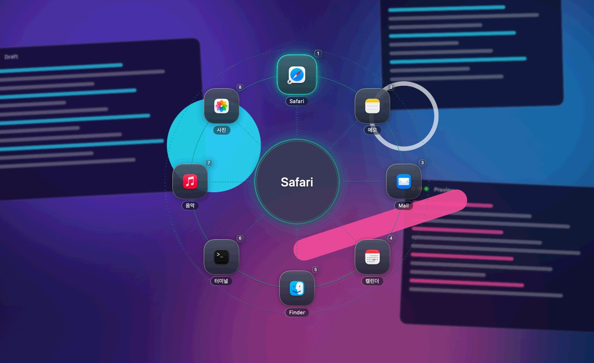
</p>

<p align="center">
  <b>단축키 하나로 화면 가운데에 열리는 8칸 방사형 런처</b><br>
  macOS 메뉴바에 상주하며, 방향키·숫자 한 번으로 앱을 전환하고 URL을 열고 텍스트를 복사하고 매크로를 실행합니다.
</p>

<p align="center">
  
  
  
  
</p>

> **English summary** — QuickStream is a native macOS (14+) menu-bar app. Press **⌥Q** and an 8-slot radial launcher opens in the middle of your screen; pick a slot with the arrow keys, number keys or mouse to switch/launch an app, open a URL, copy text or run a macro. There are two themes: orbit (default) and pie. When you type a URL for a slot in Settings, the app fetches that page's title and favicon once typing pauses (the only network use besides update checks). Install with `brew install --cask eyo-25/tap/quickstream`. The UI language is Korean.

---

## 목차

- [특징](#특징)
- [테마: 오비트와 파이](#테마-오비트와-파이)
- [설치](#설치) — [Homebrew](#방법-1-homebrew-권장) · [zip 직접 받기](#방법-2-zip-직접-받기) · [소스 빌드](#방법-3-소스에서-빌드)
- [시작하기](#시작하기-3분-가이드)
- [사용법](#사용법)
- [설정 가이드](#설정-가이드)
- [디자인 갤러리](#디자인-갤러리)
- [메뉴바 메뉴와 명령줄](#메뉴바-메뉴와-명령줄)
- [설정 파일](#설정-파일)
- [업데이트와 삭제](#업데이트와-삭제)
- [문제 해결](#문제-해결)
- [개인정보와 권한](#개인정보와-권한)
- [개발](#개발)
- [라이선스](#라이선스)

---

## 특징

- **8슬롯 방사형 런처** — 슬롯마다 앱 · URL · 클립보드 텍스트 · 매크로를 지정합니다. 키보드만으로 끝나고, 마우스로도 됩니다.
- **두 가지 모양** — 유리 타일이 원 궤도를 도는 **오비트**(기본)와 부채꼴 8조각 **파이**.
- **여러 탭** — 탭을 최대 8개까지 만들어 `Tab` 으로 넘깁니다. 탭은 항상 하나 이상 있습니다.
- **꾸밀 수 있는 디자인** — 본체 3종(다크 그레이 / 다크 글라스 / 클리어 글라스 + 틴트 색), 포커스 스타일(플랫 / 네온), 포커스 색(프리셋 14개 + 원하는 색), 포커스 불빛 켜고 끄기, 크기·글자 굵기 조절.
- **읽기 쉬운 색** — 선택된 칸의 글자는 어떤 색을 골라도 대비 4.5 이상이 되도록 자동으로 맞춥니다.
- **삼성 One UI 풍 설정 창** — 설정 창 색도 고른 본체·포커스 색을 따라가고, 미리보기가 실시간으로 바뀝니다.
- **가볍고 안전** — 순수 Swift(AppKit · SwiftUI), 추가 권한 불필요, 슬롯 동작으로 셸·임의 스크립트를 실행하지 않음, 네트워크는 업데이트 확인과 설정에서 URL 을 넣을 때의 제목·파비콘 조회에만 사용.
- **Apple Silicon · Intel 모두 지원** (유니버설 바이너리), macOS 14 Sonoma 이상.

<p align="center">
  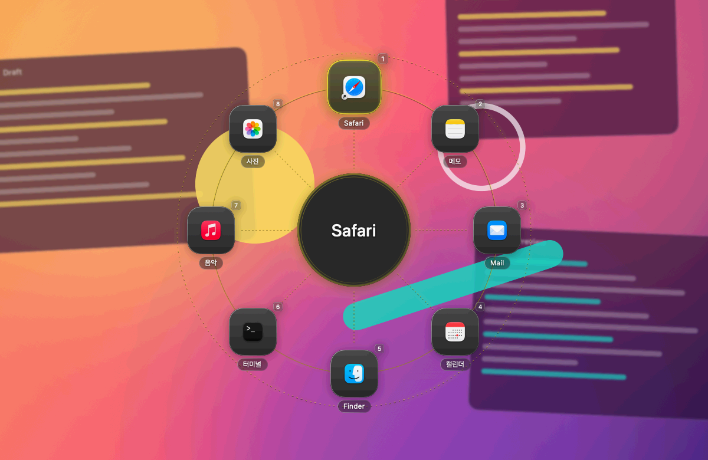
  
</p>

---

## 테마: 오비트와 파이

테마는 **두 가지**입니다. **오비트가 기본**이고, 파이는 **설정 › 패널 모양 › 모양 › 테마 카드**에서 고릅니다. 새로 설치하면 오비트 · 다크 글라스 · 네온 민트 · 투명도 0.4 로 열립니다.

| 오비트 (기본) | 파이 |
| --- | --- |
| 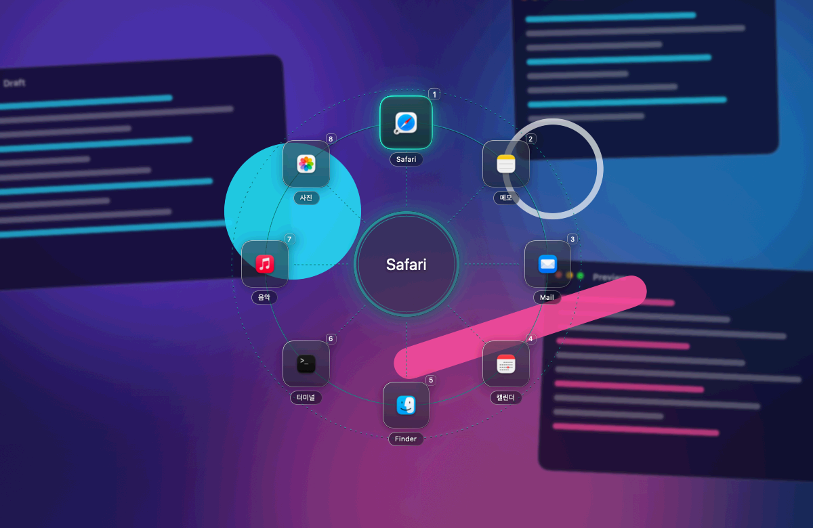 |  |
| 둥근 유리 타일 8개가 원 궤도에 놓이고, 가운데 원판에 선택된 항목의 이름이 뜹니다. 타일 아래의 이름 라벨과 번호 배지는 끌 수 있습니다. | 부채꼴 8조각이 고리를 이룹니다. 선택된 앱의 이름을 **위 / 가운데 원 / 숨김** 중에서 고릅니다(파이 전용). |

- 두 테마의 **조작은 같습니다**: 키(방향키 · 숫자 · Tab · Enter · Esc), 마우스(방향으로 고르기 · 클릭 규칙), 슬롯과 탭도 그대로입니다. 그리는 방식만 다릅니다.
- **크기는 테마별로 따로 기억합니다.** 오비트와 파이가 각자의 바깥 크기 · 중앙 원 크기 · 테두리 굵기를 가지며, 테마를 바꿔도 서로 덮어쓰지 않습니다.

---

## 설치

### 요구 사항

| 항목 | 내용 |
| --- | --- |
| macOS | 14 Sonoma 이상 |
| 칩 | Apple Silicon · Intel 모두 (유니버설) |
| 권한 | 추가 권한 불필요 (손쉬운 사용 · 화면 기록 등을 요구하지 않습니다) |

### 방법 1. Homebrew (권장)

퀵스트림은 자체 Homebrew tap([`eyo-25/homebrew-tap`](https://github.com/eyo-25/homebrew-tap))으로 배포됩니다.

**① Homebrew 가 있는지 확인합니다.**

```sh
brew --version
```

없다면 [brew.sh](https://brew.sh) 안내대로 먼저 설치하세요.

**② 설치합니다.**

```sh
brew install --cask eyo-25/tap/quickstream
```

이 한 줄이 tap 추가와 앱 설치를 함께 합니다. `eyo-25/tap/quickstream` 은 `<tap 이름>/<cask 이름>` 이라는 뜻이며, tap 이 이미 추가돼 있지 않으면 자동으로 추가합니다. Homebrew 7 이상은 공식이 아닌 tap 의 cask 를 **신뢰한 뒤에만** 불러오는데, 위처럼 전체 이름을 직접 적어 설치하면 그 cask 하나가 자동으로 신뢰됩니다(설치 중 `Trusted cask eyo-25/tap/quickstream` 이라고 나옵니다).

두 단계로 나눠 하고 싶다면 tap 을 먼저 추가한 뒤 **직접 신뢰**해야 합니다.

```sh
brew tap eyo-25/tap
brew trust --cask eyo-25/tap/quickstream   # Homebrew 7 이상. brew trust 명령이 없는 이전 버전에서는 건너뜁니다
brew install --cask quickstream
```

**③ 실행합니다.**

```sh
open -a QuickStream
```

`/Applications/QuickStream.app` 에 설치되므로 Spotlight(⌘Space)나 Launchpad 에서도 열 수 있습니다. 실행하면 메뉴바에 아이콘이 나타나고, 곧바로 **⌥Q**(Option+Q)로 오버레이를 열 수 있습니다. → [시작하기](#시작하기-3분-가이드)

**자주 쓰는 Homebrew 명령**

| 하고 싶은 일 | 명령 |
| --- | --- |
| 설치된 버전과 cask 정보 보기 | `brew info --cask eyo-25/tap/quickstream` |
| 업데이트 | 앱 메뉴의 **업데이트 확인…** (앱이 직접 업데이트합니다), 또는 `brew upgrade --cask quickstream` |
| 삭제 (설정은 남김) | `brew uninstall --cask quickstream` |
| 설정·로그·캐시까지 완전 삭제 | `brew uninstall --zap --cask quickstream` |
| 다시 설치 | `brew reinstall --cask quickstream` |

> **참고** — `No Cask with this name exists` 가 나오면 `brew update` 로 tap 을 새로 받은 뒤 다시 시도하세요. 퀵스트림은 tap 을 추가하기 전에는 `brew search quickstream` 에 나오지 않습니다. `Refusing to load cask … from untrusted tap` 이 나오면 `brew trust --cask eyo-25/tap/quickstream` 을 실행한 뒤 다시 시도하세요.

### 방법 2. zip 직접 받기

Homebrew 를 쓰지 않는 경우입니다.

1. [Releases 페이지](https://github.com/eyo-25/quickstream/releases/latest)에서 `QuickStream-<버전>.zip` 을 내려받습니다.
2. 압축을 풀고 `QuickStream.app` 을 `/Applications`(또는 `~/Applications`)로 옮깁니다.
3. **처음 한 번** 은 macOS 가 "확인되지 않은 개발자" 경고를 띄울 수 있습니다. 퀵스트림은 Apple 공증을 받지 않았기 때문입니다. 다음 중 하나로 여세요.
   - **시스템 설정 › 개인정보 보호 및 보안** 맨 아래에서 **그래도 열기** 를 누릅니다.
   - 또는 터미널에서 격리 속성을 제거합니다.

     ```sh
     xattr -dr com.apple.quarantine /Applications/QuickStream.app
     ```

> Homebrew 로 설치하면 이 단계가 설치 과정에서 자동으로 처리됩니다.

### 방법 3. 소스에서 빌드

Xcode Command Line Tools(`xcode-select --install`)가 필요합니다. Xcode 프로젝트는 없고 `swiftc` 로 바로 빌드합니다.

```sh
git clone https://github.com/eyo-25/quickstream.git
cd quickstream
./install.sh
```

앱을 빌드해 `~/Applications/QuickStream.app` 에 설치하고 엽니다. 업데이트는 앱 메뉴의 **업데이트 확인…** 으로 되고(릴리스 빌드로 바뀝니다), 소스를 직접 받아 쓰려면 `git pull` 후 `./install.sh` 를 다시 실행하세요. `--dry-run` 을 붙이면 바꾸지 않고 할 일만 보여 주고, 삭제는 `./install.sh --uninstall` 입니다(설정 폴더는 남깁니다). Homebrew 로 이미 설치돼 있으면 같은 앱이 두 벌이 되지 않도록 `install.sh` 가 멈춥니다(먼저 `brew uninstall --cask quickstream`).

### 서명과 다운로드 검증

- 퀵스트림은 **ad-hoc 서명**이며 **Apple 공증을 받지 않았습니다.** Homebrew 설치는 바로 열리도록 macOS 격리 속성을 제거하므로, 이 저장소와 tap 을 신뢰할 때만 설치하세요.
- 릴리스 zip 은 태그된 커밋에서 GitHub Actions 가 빌드하고, 서명된 빌드 출처 증명(attestation)이 붙습니다. 직접 확인하려면(GitHub CLI 필요):

  ```sh
  # X.Y.Z 는 받으려는 버전입니다(최신 버전은 Releases 페이지에서 확인하세요)
  gh release download vX.Y.Z -R eyo-25/quickstream -p 'QuickStream-*.zip'
  gh attestation verify QuickStream-X.Y.Z.zip -R eyo-25/quickstream \
    --signer-workflow eyo-25/quickstream/.github/workflows/release.yml --source-ref refs/tags/vX.Y.Z
  ```

  자세한 내용은 [SECURITY.md](SECURITY.md) 를 보세요.

---

## 시작하기 (3분 가이드)

**1. 실행합니다.** 메뉴바에 퀵스트림 아이콘이 생깁니다. Dock 에는 나타나지 않는 메뉴바 앱입니다.

**2. `⌥Q` 를 누릅니다.** 화면 가운데에 8칸 런처가 열립니다. 방향키로 칸을 고르고 `Enter`(또는 칸 번호 숫자 `1`~`8`)로 실행하며, `Esc` 로 닫습니다. 처음에는 **탭 1** 하나가 비어 있습니다.

**3. 자주 쓰는 앱을 고정합니다.** 메뉴바 아이콘 › **설정…**(⌘,) › **탭 1** 로 가서 슬롯을 눌러 앱을 고릅니다.

<p align="center">
  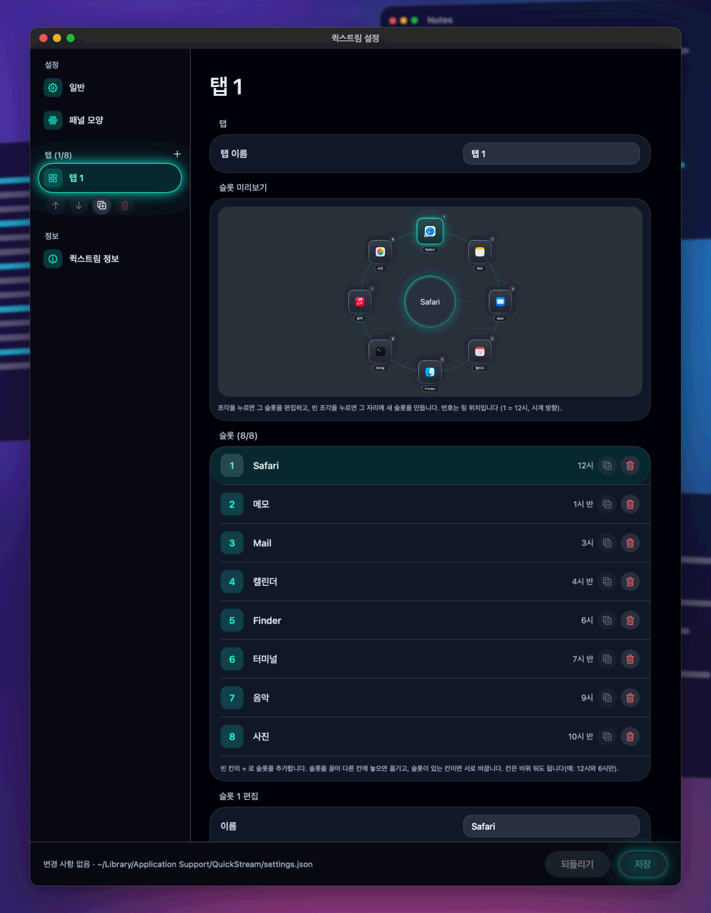
</p>

**4. (선택) 로그인할 때 자동으로 시작하게 합니다.** 설정 › **일반** › **로그인 시 자동 시작** 을 켭니다. 단축키도 같은 화면에서 바꿀 수 있습니다.

---

## 사용법

### 오버레이 열기와 닫기

**⌥Q**(Option+Q)로 열고 닫습니다. 단축키는 설정에서 바꿀 수 있습니다. 오버레이가 열리면 화면 전체가 입력을 받습니다(눈에 보이지는 않습니다). 다른 앱으로 포커스가 넘어가면 오버레이만 숨기고 포커스는 건드리지 않습니다.

선택된 칸은 포커스 색으로 강조되고, 오비트에서는 중앙 원에 선택된 항목의 이름이 뜹니다(빈 칸은 `+`, 이름은 `빈 슬롯`). 칸 모서리에는 칸 번호 키(**1~8**)가 작게 표시됩니다. 선택이 바뀔 때마다 중앙 원이 은은하게 한 번 반짝입니다.

### 키보드 조작

| 키 | 동작 |
| --- | --- |
| `↑` `→` `↓` `←` | 슬롯을 링 위치로 바로 선택: 기본은 ↑ 1번(12시), → 3번, ↓ 5번, ← 7번. 두 방향키를 **함께** 누르면 대각선(↑+→ 2번, →+↓ 4번, ↓+← 6번, ←+↑ 8번). **이미 선택된 슬롯의 방향이면 한 번만 눌러도 실행**되고, 다른 슬롯을 가리키면 선택만 바뀝니다. 방향키에서 손을 뗄 때 실행되며 꾹 눌러 반복되는 입력은 해당하지 않습니다. 슬롯마다 8방향 중 다른 조합으로 바꿀 수 있습니다(설정 › 슬롯 › 방향키) |
| `1` ~ `8` | 해당 칸을 즉시 실행 (빈 칸이면 선택만). 슬롯 설정에서 영문자·숫자 키를 **하나 더**(추가 키) 지정하면 그 키로도 같은 슬롯이 실행됩니다 |
| `Enter` | 선택된 슬롯 실행 |
| `Tab` / `Shift+Tab` | 다음 / 이전 탭 (양 끝은 이어집니다) |
| `]` / `[` | 다음 / 이전 탭 |
| `Esc`, 닫기 키(기본 `Q`) | 닫고 이전 앱으로 돌아가기. 닫기 키는 설정 › 일반에서 바꿀 수 있고 `Esc` 는 항상 닫습니다 |

### 마우스 조작

마우스는 **화면 어디서든 방향으로** 칸을 고릅니다(중앙 원 안에서는 바뀌지 않습니다).

| 클릭 위치 | 동작 |
| --- | --- |
| 링 안의 칸 | 그 칸 실행 |
| 링 바깥(투명한 영역) | **현재 선택된 칸 실행** |
| 가운데 원 | 닫기 (실행 없음) |

> 링 바깥을 눌러도 닫히기만 하는 게 아니라 선택된 칸이 실행된다는 점에 주의하세요. 닫으려면 `Esc`, 닫기 키(`Q`), 또는 가운데 원을 누릅니다.

### 슬롯에 지정할 수 있는 동작

| 동작 종류 | 하는 일 |
| --- | --- |
| 앱 실행/전환 | 실행 중이면 앞으로 가져오고, 꺼져 있으면 실행합니다. 설치된 앱을 검색해 고릅니다 |
| URL 열기 | 기본 브라우저로 엽니다. `http` / `https` 만 허용합니다. 설정에서 URL 을 입력하면 그 페이지의 제목이 슬롯 이름·약어가 되고 파비콘이 슬롯 아이콘이 됩니다 |
| 클립보드 텍스트 | 정해 둔 텍스트를 클립보드에 복사합니다 |
| 매크로 | 위 동작을 순서대로 실행합니다 (최대 16단계, 중첩 불가) |

셸·임의 스크립트 실행은 지원하지 않습니다.

### 탭

- 처음에는 비어 있는 **탭 1** 하나가 있습니다. 설정 사이드바의 `+` 로 탭을 추가하고(최대 8개) 이름 변경 · 순서 이동(사이드바에서 끌어다 놓거나 위/아래 버튼) · 복제 · 삭제를 할 수 있습니다. 탭은 마지막 하나를 지울 수 없어서 항상 하나 이상 남습니다.
- 예전의 '고정 앱' / '커스텀' 탭 구분은 없어졌습니다. 옛 설정 파일도 그대로 읽힙니다.

탭은 오버레이 화면에 표시되지 않고 `Tab` / `Shift+Tab` / `[` `]` 로만 넘깁니다.

---

## 설정 가이드

메뉴바 아이콘 메뉴의 **설정…**(⌘,)에서 엽니다. 왼쪽 사이드바에서 화면을 고르고, 오른쪽에서 편집하며, 아래 **저장** 을 눌러야 적용됩니다. 저장하지 않고 닫거나 종료하면 **적용 / 닫기 / 취소** 를 묻습니다.

### 일반

<p align="center">
  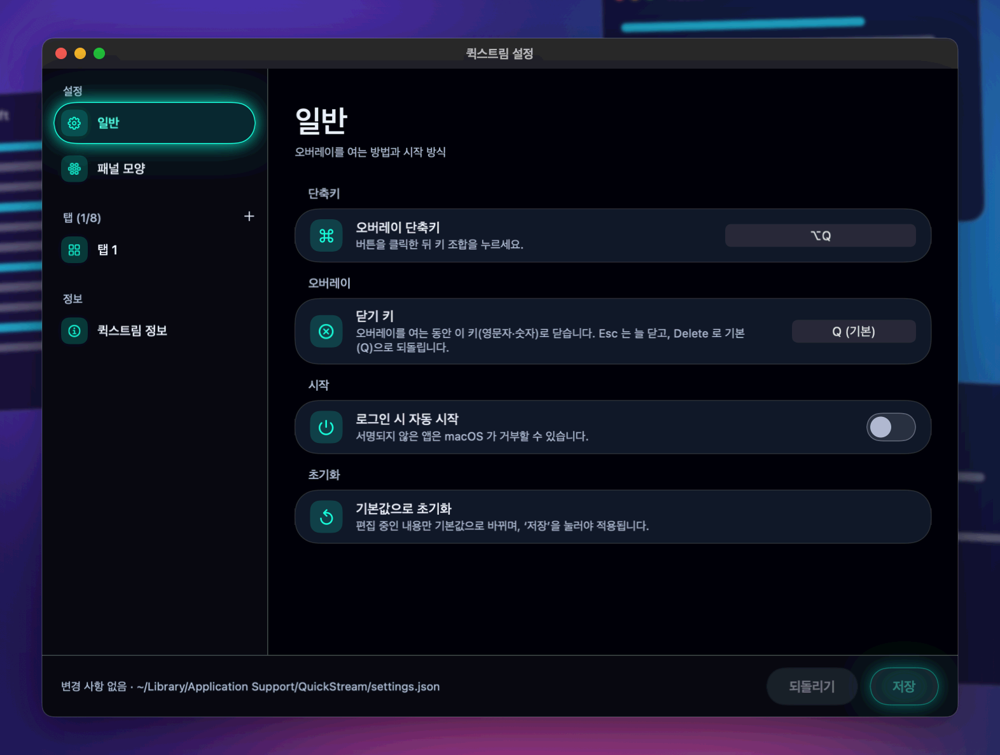
</p>

- **전역 단축키**: 버튼을 누른 뒤 원하는 키 조합을 누르세요.
- **로그인 시 자동 시작**: macOS 로그인 항목으로 등록합니다.
- **기본값으로 초기화**: 편집 중인 내용만 기본값으로 바꾸며, 저장해야 적용됩니다.

다른 앱이 같은 조합을 이미 쓰고 있어도 충돌이 항상 감지되는 것은 아닙니다. ⌥Q 가 다른 앱과 겹쳐 둘 다 반응하면 조합을 바꾸세요.

### 패널 모양

위쪽에 **지금 설정의 실제 모양이 미리보기로 고정**되어 있어, 아래에서 바꾸는 값이 즉시 반영됩니다. 아래 탭은 세 개입니다.

#### ① 모양

<p align="center">
  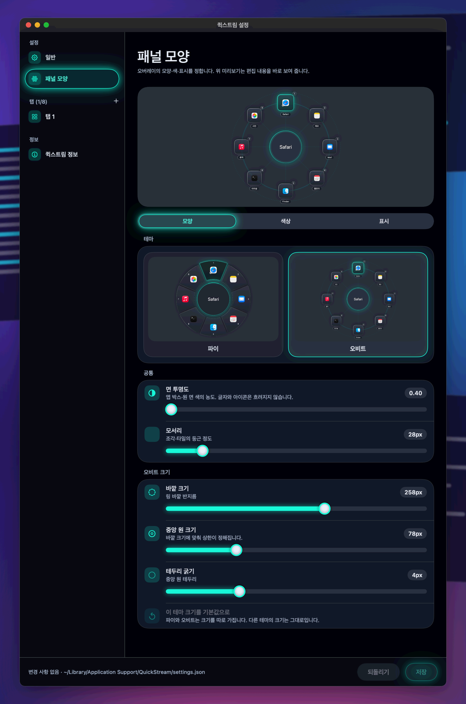
</p>

- **테마 카드**: 오비트 / 파이 중 선택
- **면 투명도 · 모서리**: 두 테마 공통
- **바깥 크기 · 중앙 원 크기 · 테두리 굵기**: 오비트와 파이가 **각자의 크기**를 가지며 테마를 바꿔도 서로 덮어쓰지 않습니다. '이 테마 크기를 기본값으로' 버튼도 있습니다.

#### ② 색상

<p align="center">
  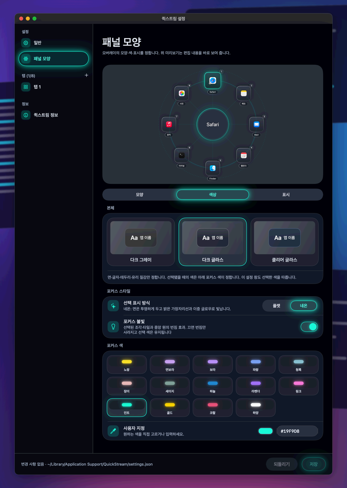
</p>

색은 **본체**와 **포커스** 두 단계로 따로 고릅니다.

- **본체** — 면·글자·테두리·유리 질감을 정합니다. 선택 색은 들어 있지 않습니다.
  - **다크 그레이**: 회색 면, 흰 글씨
  - **다크 글라스**(기본): 푸른빛 블랙 유리. 바탕화면이 실제로 비칩니다
  - **클리어 글라스**: 바탕화면이 비치는 투명한 유리에 고른 **틴트 색**을 입힙니다. 프리셋 8개 또는 `#RRGGBB` 직접 입력. 틴트가 아주 밝아도 글자가 읽히도록 면 아래에 옅은 어두운 막을 깝니다
- **포커스 스타일**
  - **플랫**: 선택된 칸을 포커스 색으로 채웁니다
  - **네온**(기본): 면은 투명하게 두고 밝은 가장자리선과 이중 글로우로 빛납니다
  - **포커스 불빛**: 끄면 번짐·글로우·중앙 원 빛·포커스 변경 반짝임이 사라지고 면 틴트와 테두리선만 남습니다. 설정 창에도 적용됩니다
- **포커스 색**: 프리셋 14개를 고르거나 색 선택기 · `#RRGGBB` 로 원하는 색을 직접 지정합니다

설정 창 자체도 이 선택을 따라갑니다. 면·글자는 고른 본체 색을, 강조(선택된 사이드바 행, 토글, 세그먼트, 저장 버튼)는 포커스 색을 씁니다.

<p align="center">
  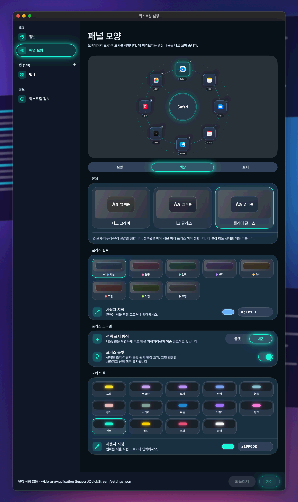
</p>

#### ③ 표시

<p align="center">
  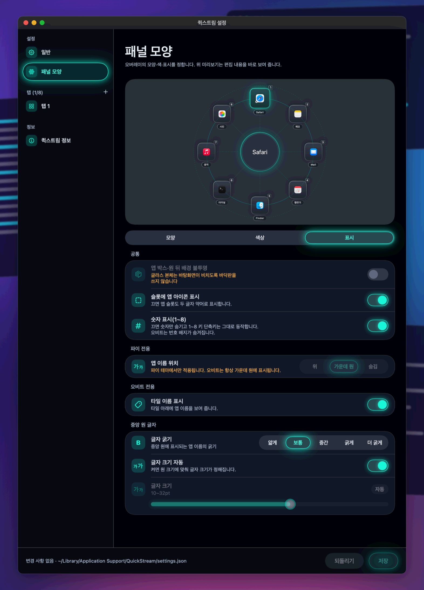
</p>

- **앱 박스 · 원 뒤 배경 불투명**: 다크 그레이에서 바탕화면이 비치지 않게 불투명한 바닥판을 까는 옵션입니다(기본 켬). 글라스 본체는 바탕화면이 비치도록 바닥판을 쓰지 않으므로 이 토글이 비활성입니다
- **앱 아이콘 · 숫자(1~8)** 표시 여부
- **앱 이름 위치**(파이 전용): 위 / 가운데 원 / 숨김. 오비트는 항상 가운데 원판에 이름이 뜹니다
- **타일 이름 표시**(오비트 전용): 타일 아래의 이름 라벨 켜고 끄기
- **중앙 원 글자**: 굵기 5단계(얇게 ~ 더 굵게)와 크기(자동 또는 10~32pt)

### 탭 · 슬롯

<p align="center">
  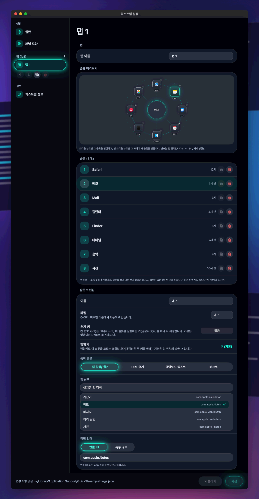
</p>

사이드바의 **탭** 목록에서 탭을 고르거나 `+` 로 추가합니다. 슬롯은 링 위치 **8칸**(1번 = 12시, 시계 방향)이 처음부터 모두 보이고, 칸은 **비워 둬도 됩니다**(예: 12시와 6시만 채우기). 8칸 링 미리보기나 목록의 빈 칸 `+` 를 누르면 그 자리에 슬롯이 추가되고, 슬롯을 누르면 그 슬롯을 편집합니다.

- 슬롯 **추가(빈 칸의 +) · 복제 · 삭제**: 삭제해도 뒤 슬롯이 당겨지지 않고 그 칸만 비워집니다.
- **끌어서 위치 바꾸기**: 목록에서 슬롯을 끌어 다른 칸에 놓으면 옮겨지고, 슬롯이 있는 칸에 놓으면 서로 바뀝니다.
- **이름 · 라벨**(칸에 보일 약어)
- **추가 키**: 칸 번호 키(1~8)는 그대로 쓰고, 이 슬롯을 실행하는 키(영문자·숫자 한 글자)를 하나 더 지정합니다. 기본은 없음입니다. 버튼을 누르고 키를 누르면 지정되고 `Delete` 로 지웁니다. 숫자 1~8, 닫기 키, 같은 탭의 다른 슬롯의 추가 키는 고를 수 없습니다.
- **방향키**: 방향키로 이 슬롯을 고르는 조합(↑ ↗ → ↘ ↓ ↙ ← ↖ 중 하나, 또는 없음). 기본은 링 위치의 방향입니다. 같은 탭의 다른 슬롯이 쓰는 방향은 고를 수 없습니다.
- **동작 편집**: 앱 / URL / 클립보드 텍스트 / 매크로. URL 을 입력하고 잠시(약 1초) 멈추면 그 페이지의 제목·파비콘을 가져와 **이름 · 라벨은 제목과 그 약어로, 아이콘은 파비콘으로** 정합니다(앱을 고를 때처럼 직접 정한 이름도 덮어씁니다. 제목을 못 읽으면 호스트 이름을 씁니다. 기다리는 사이 이름을 직접 고쳤으면 이름은 그대로 둡니다).

오버레이를 닫는 키는 설정 › **일반** › **닫기 키**에서 바꿉니다(기본 `Q`, 영문자·숫자 한 글자). `Esc` 는 늘 닫습니다.

### 정보

<p align="center">
  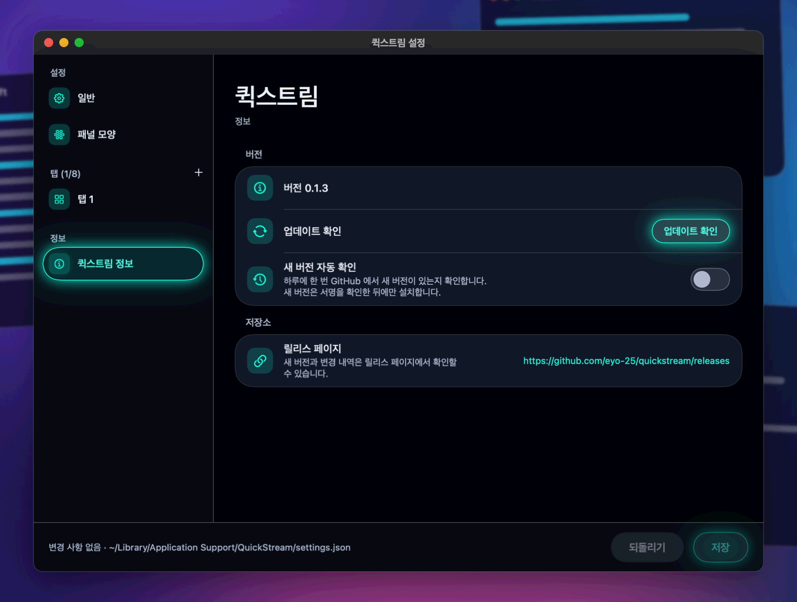
</p>

버전을 확인하고, **업데이트 확인** 을 누르거나 **새 버전 자동 확인** 을 켜고 끌 수 있습니다.

### 저장할 때 일어나는 일

저장은 **검증 → 단축키 등록 시험 → 기존 파일을 `settings.json.bak` 으로 백업 → 원자적 저장 → 적용** 순서입니다. 어느 단계든 실패하면 파일과 단축키는 이전 상태 그대로이고 사유가 표시됩니다. 성공하면 설정 창이 닫히고, 실패하거나 검증에 막히면 열려 있어 사유를 볼 수 있습니다.

---

## 디자인 갤러리

### 테마 × 포커스 스타일

테마별 모양은 위의 [테마: 오비트와 파이](#테마-오비트와-파이)에 있습니다. 여기서는 같은 테마에서 포커스 스타일(네온 / 플랫)만 바꿔 비교합니다.

| | 네온 | 플랫 |
| --- | --- | --- |
| **오비트** |  | 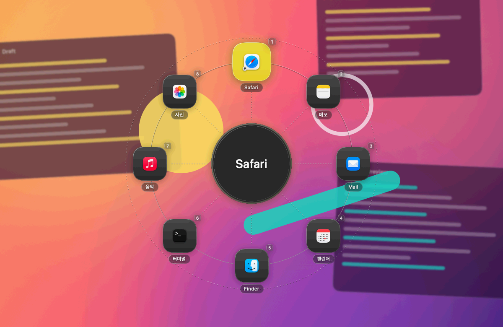 |
| **파이** |  | 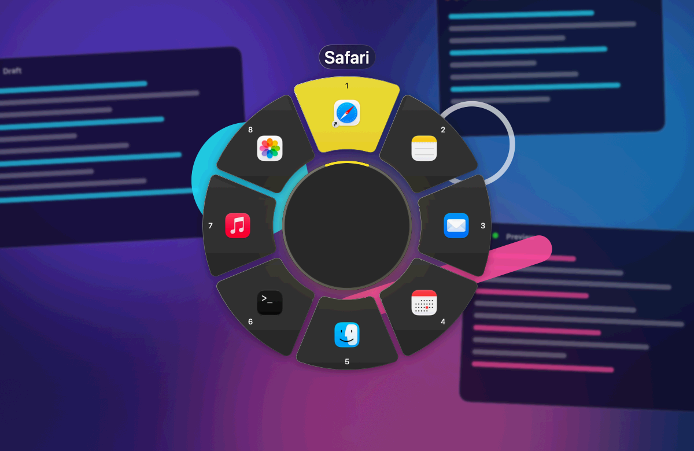 |

### 본체 3종

같은 오비트를 같은 배경 위에 놓고 본체만 바꾼 모습입니다. 글라스 본체는 뒤의 배경이 비칩니다.

| 다크 그레이 | 다크 글라스 |
| --- | --- |
| 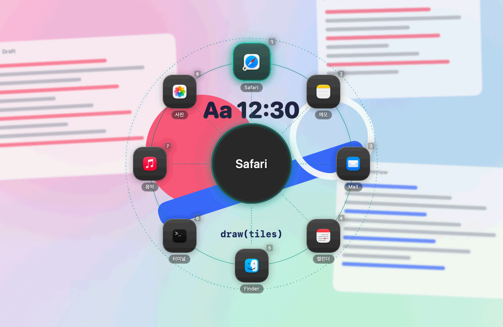 |  |

| 클리어 글라스 · 하늘 | 클리어 글라스 · 분홍 |
| --- | --- |
| 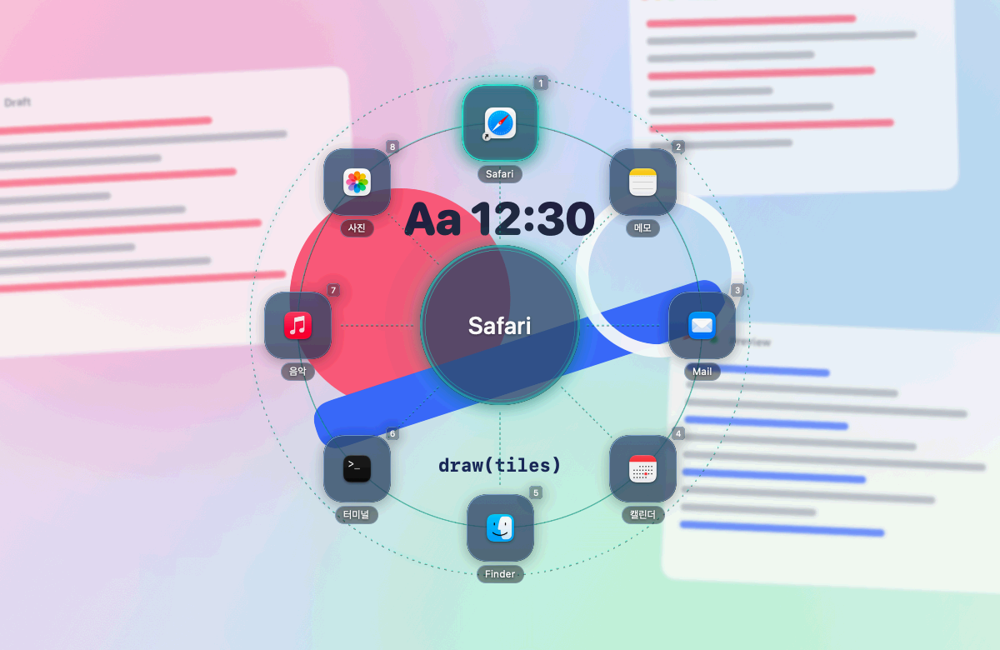 | 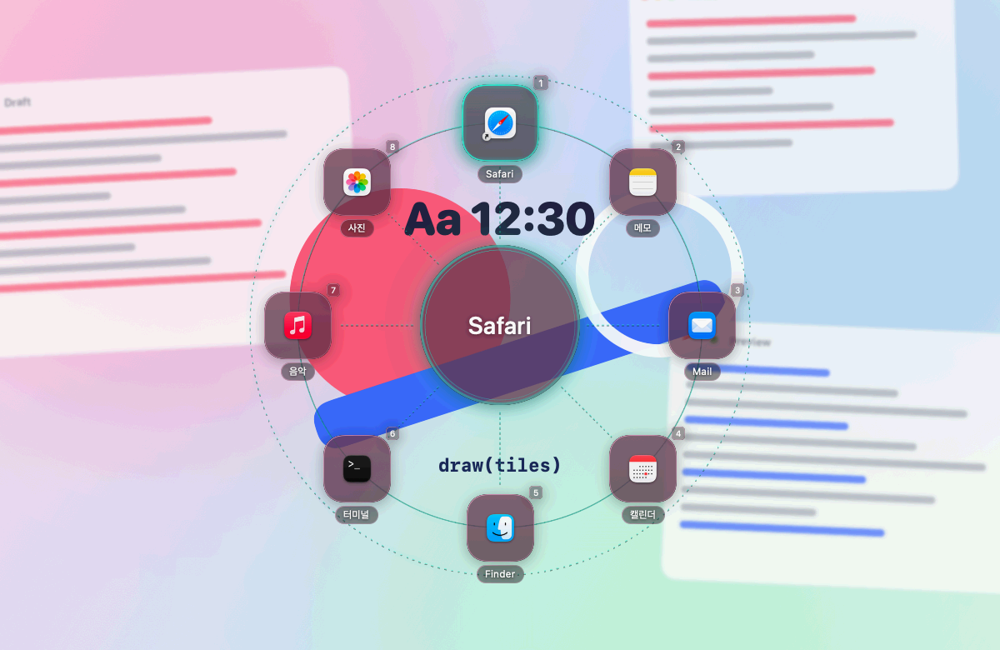 |

### 포커스 색

프리셋 14개 외에 원하는 색을 직접 지정할 수 있습니다. 아래는 노랑 · 민트 · 핑크 · 파랑 · 보라 · 코랄입니다.

<p align="center">
  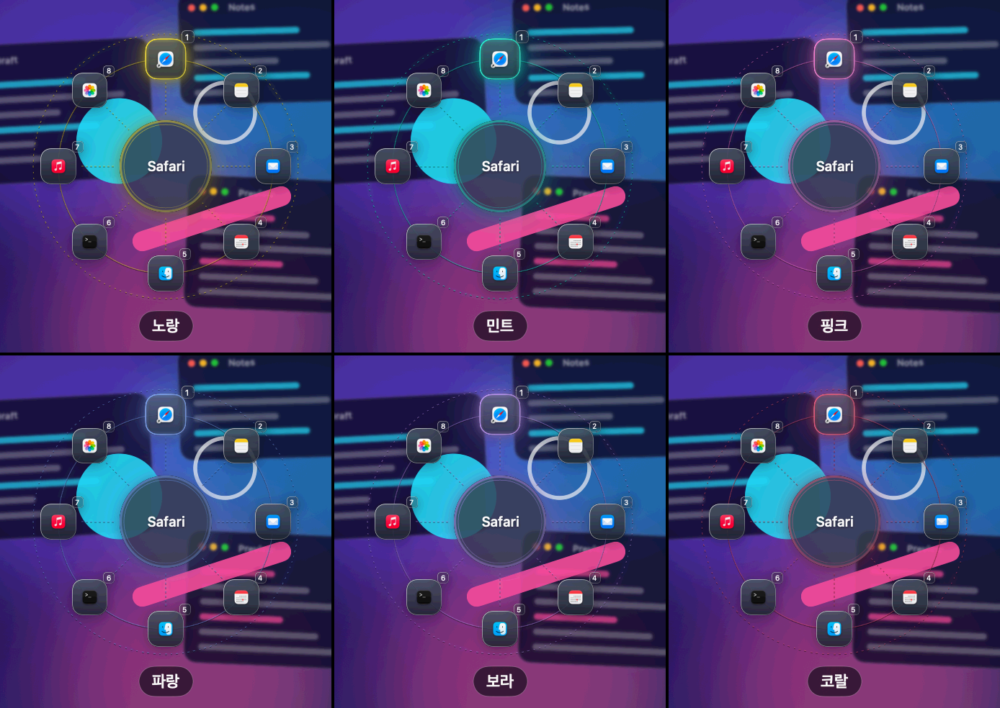
</p>

### 포커스 불빛 켬 / 끔

<p align="center">
  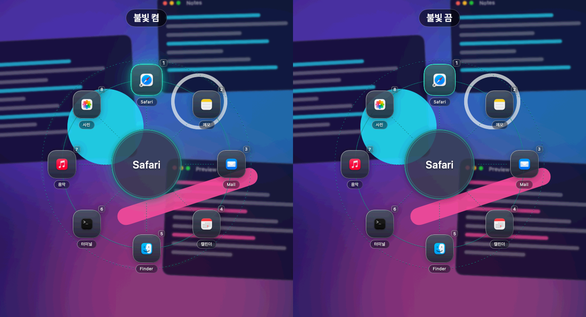
</p>

### 파이의 앱 이름 위치

| 가운데 원 | 위 |
| --- | --- |
| 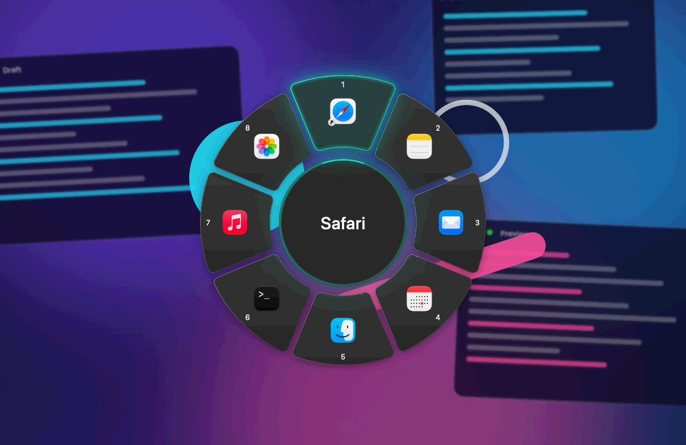 | 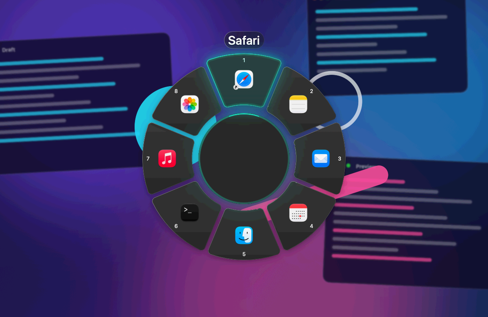 |

### 번호와 타일 이름 숨기기

<p align="center">
  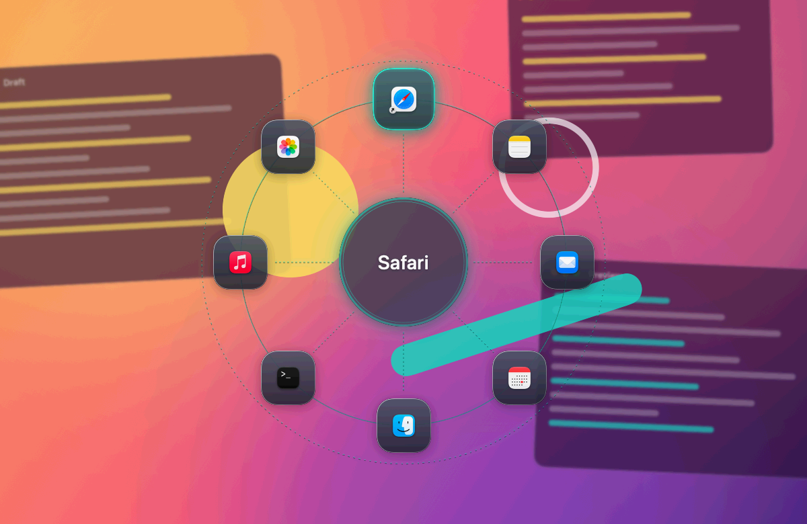
</p>

> 이 이미지들은 앱의 실제 화면 코드를 가상 배경 위에 그려서 만든 것입니다(`tools/make-screenshots.sh`). 실제 사용 중인 화면과 글꼴 렌더링이 조금 다를 수 있습니다.

---

## 메뉴바 메뉴와 명령줄

메뉴바 아이콘을 누르면 나오는 메뉴입니다.

| 항목 | 설명 |
| --- | --- |
| **퀵스트림 열기 (⌥Q)** | 오버레이 열기 |
| **설정…** (⌘,) | 설정 창 열기 |
| **업데이트 확인… / 새 버전 X 업데이트…** | 새 버전 확인 · 설치(자동 확인이 찾은 새 버전은 이 항목으로 알려 줍니다) |
| **JSON 파일 열기** | `settings.json` 을 기본 편집기로 열기 |
| **설정 다시 불러오기** | 파일을 직접 고친 뒤 앱에 반영 |
| **퀵스트림 종료** (⌘Q) | 종료. 설정 창에 저장하지 않은 변경이 있으면 먼저 묻습니다 |

이미 실행 중인 앱에 명령줄로 신호를 보낼 수도 있습니다(스크립트·다른 런처 연동용).

```sh
/Applications/QuickStream.app/Contents/MacOS/QuickStream --show       # 오버레이 열기
/Applications/QuickStream.app/Contents/MacOS/QuickStream --settings   # 설정 창 열기
```

Finder · Spotlight 에서 이미 실행 중인 앱을 다시 열어도 설정 창이 열립니다.

---

## 설정 파일

설정은 `~/Library/Application Support/QuickStream/settings.json` 에 저장됩니다(첫 실행 시 기본값이 만들어집니다). 직접 편집해도 되고, 편집한 뒤 메뉴의 **설정 다시 불러오기** 를 누르면 반영됩니다. 검증에 실패한 파일은 덮어쓰지 않고 기본값으로 동작하며 사유를 보여 줍니다. 그 상태에서 설정 창에서 저장하면 깨진 파일이 `.bak` 으로 보존됩니다. 이전 Electron 판의 설정 파일과 형식이 같습니다.

최상위 키는 `shortcut`, `launchAtLogin`, `closeKey`, `overlay`, `tabs` 입니다. `overlay` 아래 값은 다음과 같습니다. 형식이 틀린 색이나 알 수 없는 열거형 값은 파일 전체를 버리지 않고 기본값으로 읽습니다. 반면 **숫자가 허용 범위를 벗어나면**(`alpha` 0.4~0.95, `radius` 24~56, 링 `ring` 160~320, 중앙 `center` 40~(ring−72), 테두리 `border` 1~12) 검증 실패로 처리되어 **파일 전체가 기본값으로 대체**됩니다(파일은 덮어쓰지 않고 사유가 표시됩니다).

| 키 | 값 | 기본 |
| --- | --- | --- |
| `theme` | `"orbit"` / `"pie"` | `"orbit"` |
| `bodyTheme` | `"dark-gray"` / `"dark-glass"` / `"clear-glass"` | `"dark-glass"` |
| `glassTintHex` | `"#RRGGBB"` (클리어 글라스의 틴트 색) | `"#6FB1FF"` |
| `focusStyle` | `"neon"` / `"flat"` | `"neon"` |
| `focusHex` | `"#RRGGBB"` (포커스 색) | `"#19F9D8"` (민트) |
| `focusGlow` | `true` / `false` (포커스 불빛) | `true` |
| `alpha` | 면 투명도 | `0.4` |
| `radius` | 모서리 | `28` |
| `pieSizes` · `orbitSizes` | `{ "ring": …, "center": …, "border": … }` 테마별 크기 | 파이 250/112/4 · 오비트 258/78/4 |
| `solidBacking` | 불투명 바닥판 (다크 그레이만) | `true` |
| `showIcons` · `showNumbers` · `showTileLabels` | 아이콘 · 숫자 · 오비트 타일 이름 표시 | `true` |
| `namePlacement` | 파이의 이름 위치 `"top"` / `"center"` / `"hidden"` | `"center"` |
| `centerNameWeight` | `"light"` `"regular"` `"medium"` `"semibold"` `"bold"` | `"regular"` |
| `centerNameSize` | 중앙 원 글자 크기 pt (`0` = 자동, 10~32) | `0` |

최상위에는 `closeKey`(오버레이 닫기 키, 소문자 한 글자, 기본 `"q"`)도 있습니다. 슬롯에는 선택 항목으로 `key`(칸 번호 키 말고 하나 더 실행하는 추가 키, 소문자 한 글자, 숫자 1~8 은 불가)와 `direction`(`"up"` `"up-right"` `"right"` `"down-right"` `"down"` `"down-left"` `"left"` `"up-left"` `"off"`)를 둘 수 있습니다. 없으면 추가 키 없음, 링 위치 방향입니다. 손으로 고친 `key`·`direction`·`closeKey` 가 틀리면 파일 전체를 버리지 않고 그 값만 지정 없음(`closeKey` 는 `"q"`)으로 읽고, 대문자 키는 소문자로 읽습니다.

---

## 업데이트와 삭제

앱은 하루에 한 번 GitHub 릴리스의 `appcast.xml` 을 받아 새 버전이 있는지 확인합니다(설정 › 정보의 **새 버전 자동 확인** 으로 끌 수 있습니다). 새 버전을 찾으면 창을 갑자기 띄우지 않고 메뉴의 **새 버전 X 업데이트…** 항목으로 알려 주며, 그 항목이나 **업데이트 확인…** 을 누르면 변경 내역과 함께 업데이트 창이 열립니다. 설치를 고르면 새 버전 zip 을 받아 **앱에 들어 있는 공개키로 서명을 확인한 뒤에만** 앱을 바꾸고 다시 엽니다. 서명이 맞지 않으면 설치하지 않습니다. 저장하지 않은 설정이 있으면 종료 전에 먼저 묻습니다.

- **0.1.3 이상**부터 이 방식입니다. 0.1.2 이하에는 업데이트 기능이 달라서 0.1.3 으로는 한 번 직접 설치해야 합니다(Homebrew 설치본은 예전 방식 그대로 `brew upgrade` 가 0.1.3 으로 올립니다).
- Homebrew 로 설치한 경우에도 앱이 직접 업데이트할 수 있고, 터미널에서 `brew upgrade --cask quickstream` 을 써도 됩니다.
- 앱이 있는 폴더에 쓸 권한이 없으면(예: 관리자 소유의 `/Applications`) macOS 가 암호를 물을 수 있습니다.

직접 하려면:

```sh
brew upgrade --cask quickstream            # 업데이트
brew uninstall --cask quickstream          # 앱 삭제
brew uninstall --zap --cask quickstream    # 설정·로그·캐시·환경설정까지 삭제
```

zap 은 `~/Library/Application Support/QuickStream`(설정·로그)와 이전 Electron 판의 설정 폴더(`퀵스트림`), 캐시, 환경설정, 저장된 창 상태를 지웁니다. 로그인 시 자동 시작은 macOS 로그인 항목이므로 삭제 전에 설정에서 꺼 두면 깔끔합니다.

---

## 문제 해결

| 증상 | 해결 |
| --- | --- |
| "열 수 없습니다" 라고 나옴 | **시스템 설정 › 개인정보 보호 및 보안** 에서 **그래도 열기**, 또는 `xattr -dr com.apple.quarantine /Applications/QuickStream.app`. zip 을 직접 받았거나 cask 의 격리 제거 단계가 실패했을 때 생깁니다 |
| `brew install` 이 `No Cask with this name` 이라고 함 | `brew update` 후 다시 시도하세요. 전체 이름 `eyo-25/tap/quickstream` 으로 설치해야 합니다 |
| `Refusing to load cask … from untrusted tap` 이라고 함 | Homebrew 7 이상은 신뢰하지 않은 tap 의 cask 를 불러오지 않습니다. `brew trust --cask eyo-25/tap/quickstream` 을 실행한 뒤 다시 시도하세요 |
| 메뉴바에 아이콘이 안 보임 | 노치가 있는 Mac 은 다른 메뉴바 항목이 가릴 수 있습니다. 일부를 종료하거나, macOS 26 이상은 **시스템 설정 › 메뉴 막대** 를 확인하세요 |
| ⌥Q 가 반응하지 않거나 다른 앱도 반응함 | 다른 앱과 단축키가 겹친 것입니다. 설정 › 일반에서 조합을 바꾸세요 |
| 설정이 기본값으로 돌아감 | 메뉴에 표시된 사유를 확인하세요. `settings.json` 이 깨졌다면 파일은 그대로 두고 기본값으로 동작합니다. 설정 창에서 저장하면 깨진 파일이 `.bak` 으로 남습니다 |
| 로그인 시 자동 시작이 안 됨 | 설정에서 다시 켜고 **시스템 설정 › 일반 › 로그인 항목** 에서 퀵스트림이 허용되어 있는지 확인하세요 |
| 글라스 본체에서 글자가 잘 안 보임 | 기본 투명도(0.4)는 허용 범위의 가장 투명한 쪽이라, 아주 밝은 바탕화면 위에서는 글라스의 흰 글자 대비가 떨어집니다(어두운 바탕에서는 읽힙니다). 설정 › 패널 모양 › 모양에서 투명도를 0.74 이상으로 올리거나 다크 그레이(불투명 바닥판)를 쓰세요 |
| 링 바깥을 눌렀더니 앱이 실행됨 | 의도된 동작입니다. 링 바깥 클릭은 선택된 칸을 실행합니다. 닫으려면 `Esc`, `Q`, 가운데 원을 쓰세요 |
| URL 슬롯의 이름·아이콘이 안 바뀜 | 이름·아이콘은 설정 창에서 URL 을 **입력할 때만** 가져옵니다(입력이 멈출 때마다, 마지막 입력 약 1초 뒤, 호스트에 점이 있는 주소만. 앱을 시작하거나 설정을 저장·다시 불러올 때는 받은 파일을 읽을 뿐 다시 요청하지 않습니다). 사이트가 봇을 막거나 응답이 늦거나(8초) 아이콘이 SVG 뿐이면 이름은 호스트 이름, 아이콘은 초기 글자로 남습니다. URL 을 한 글자 고쳐 다시 입력하면 다시 가져옵니다. 받아 둔 아이콘은 `~/Library/Application Support/QuickStream/favicons/` 에 있고 지워도 됩니다 |
| **업데이트가 안 됨** | 인터넷 연결과 앱이 있는 폴더의 쓰기 권한을 확인하세요(관리자 소유 폴더면 암호를 묻습니다). 설정 › 정보에서 **업데이트 확인** 을 눌러 오류 메시지를 읽고, 그래도 안 되면 [릴리스 페이지](https://github.com/eyo-25/quickstream/releases)에서 직접 받아 설치하세요. 0.1.2 이하는 0.1.3 으로 한 번 직접 설치해야 합니다 |

그 밖의 문제는 [Issues](https://github.com/eyo-25/quickstream/issues) 에 신고해 주세요. 버그 신고 양식에 필요한 정보가 나와 있습니다. 보안 취약점은 공개 이슈가 아니라 [SECURITY.md](SECURITY.md) 의 비공개 경로로 알려 주세요.

---

## 개인정보와 권한

- **추가 권한이 필요 없습니다.** 손쉬운 사용, 화면 기록, 전체 디스크 접근 등을 요구하지 않습니다.
- **네트워크는 두 곳에만** 씁니다. ① 업데이트: 하루에 한 번(설정 › 정보에서 끌 수 있음) GitHub 의 `appcast.xml` 을 받아 새 버전이 있는지 보고, 업데이트를 고르면 새 버전 zip 을 받습니다. 요청에 담기는 것은 앱 이름·버전(User-Agent)과 IP·시간뿐이고 시스템 정보 같은 추가 정보는 보내지 않으며, 받은 zip 은 앱에 들어 있는 공개키로 서명을 확인한 뒤에만 설치합니다. ② 설정에서 슬롯에 URL 을 입력했을 때, 입력이 멈추면 그 주소의 페이지(HTML 앞부분)와 파비콘을 받아 이름·아이콘에 쓰는 조회(쿠키 없이, 입력할 때만 — 오버레이를 열 때나 슬롯을 실행할 때는 하지 않습니다). 사용 기록·텔레메트리를 보내지 않습니다. 암호화 없는 `http://` 주소는 macOS 보안 정책(ATS)에 막혀 조회되지 않을 수 있고, 그러면 이름은 호스트 이름이 되고 아이콘은 초기 글자로 남습니다.
- 설정과 로그, 받아 둔 파비콘(`favicons/<호스트>.png`)은 내 Mac 의 `~/Library/Application Support/QuickStream` 에 저장되고, 업데이트 확인 기록(마지막 확인 시각 등 Sparkle 설정)만 환경설정(`~/Library/Preferences/io.github.eyo-25.quickstream.plist`)에 남습니다.
- URL 열기는 `http` / `https` 만, 슬롯 동작에 셸·임의 스크립트 실행은 없습니다.

---

## 개발

Xcode 프로젝트는 없고 `swiftc` 로 직접 빌드합니다(Swift 6.x 컴파일러를 `-swift-version 5` 언어 모드로 사용, 최소 macOS 14).

```sh
tests/swift/run.sh            # 단위 테스트 (XCTest 없이 swiftc 로 빌드·실행)
./build.sh                    # build/QuickStream.app (arm64 + x86_64 유니버설, ad-hoc 서명 + hardened runtime)
QS_ARCHS=arm64 ./build.sh     # 한 아키텍처만 빠르게
VERSION=0.2.0 ./build.sh      # 이 빌드의 버전만 덮어쓰기
./make-icon.sh                # CoreGraphics 로 assets/AppIcon.icns 재생성
tools/make-screenshots.sh     # README 스크린샷(docs/images)을 오프스크린 렌더로 다시 생성
```

- 빌드 끝에 `.github/verify-app.sh` 가 번들 구조, Info.plist 필수 키, 아키텍처 · 최소 OS, 서명, `LSUIElement` 를 검사합니다.
- 저장소 이름과 cask 이름은 `Info.plist` 의 `QSGitHubRepo`, `QSBrewCask` 한 곳에서 정해지며 앱과 스크립트가 모두 이 값을 읽습니다.
- 스크린샷 생성기는 앱 창을 띄우지 않고 SwiftUI 뷰를 오프스크린으로 그립니다. 내 설정·데이터를 읽지 않고 데모 데이터만 씁니다.

### 릴리스

`./release.sh X.Y.Z` 가 태그 · 빌드 · 검증 · 공개 · cask 갱신을 순서대로 처리합니다. 자세한 절차와 되돌리기는 [docs/RELEASING.md](docs/RELEASING.md), 변경 이력은 [CHANGELOG.md](CHANGELOG.md) 를 보세요.

---

## 라이선스

[MIT](LICENSE) © eyo-25
